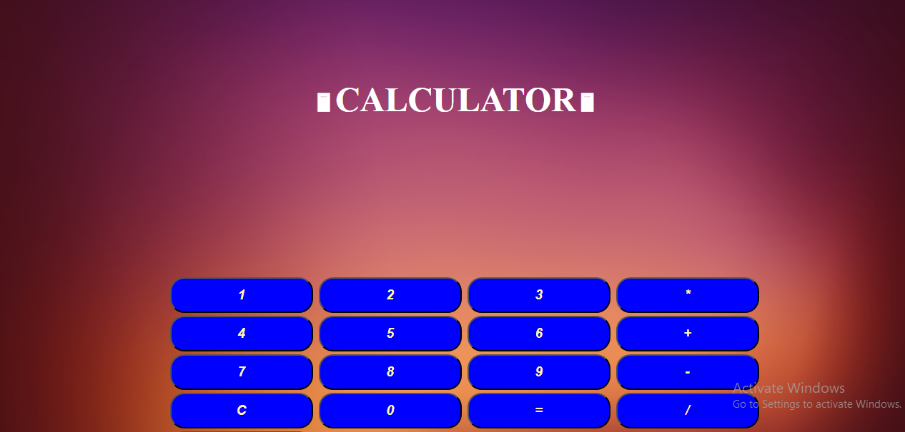

# 🖩 Calculator Web App

A simple and interactive **Calculator Web Application** built using **HTML, CSS, and JavaScript**.  
It supports basic arithmetic operations with a clean UI and real-time result preview.

---

## 📌 Features

- ➕ Addition  
- ➖ Subtraction  
- ✖️ Multiplication  
- ➗ Division  
- 🔄 Clear input and results  
- ⚡ Instant calculation after operator input  
- 🎨 Styled UI with background image  

---

## 🛠 Tech Stack

- **HTML** – Structure  
- **CSS** – Styling & layout  
- **JavaScript** – Logic and calculations  

---

## 📂 Project Structure

**Calculator**/ \
│── index.html \
│── cal.css \
│── cal.js \
│── c10.jpg \
│── README.md
---
## ▶️ How to Run the Project

1. Clone the repository:
    ```bash
    git clone https://github.com/Axe-Pearl/Mini-Projects.git

2. Navigate to the calculator project folder:
    ```bash
    cd Mini-Projects/Calculator
3. Open index.html in your browser:

    * Double-click the file \
    or
    * Use Live Server in VS Code

---

## 🧮 How It Works

* User input is displayed dynamically on screen

* When an operator (+ - * /) is entered, the calculation is triggered

* Result is previewed instantly

* Press = to finalize the computation

* C clears both input and result

---

## 📸 Screenshot


---

## ✅ Possible Improvements

* Support multiple chained operations

* Add keyboard input support

* Improve mobile responsiveness

* Add dark/light mode

---

## 🤝 Contribution

Contributions are welcome!
Feel free to improve UI, optimize logic, or add new features.
---
## 📄 License

This project is part of the Mini-Projects repository and is open for educational use.